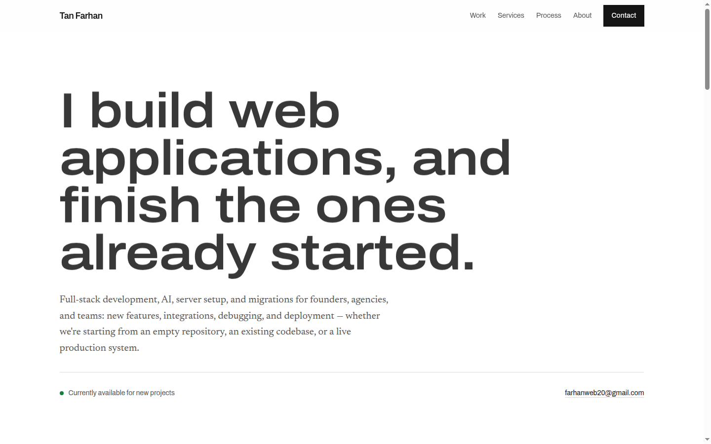
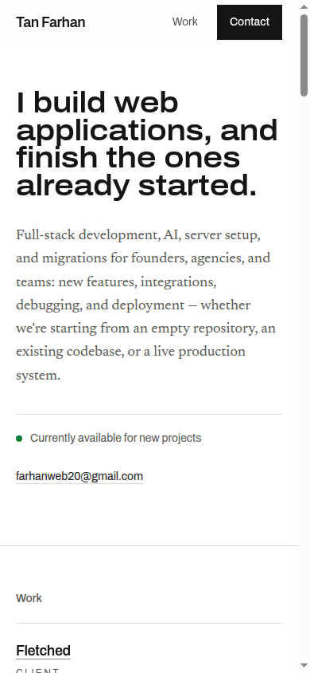
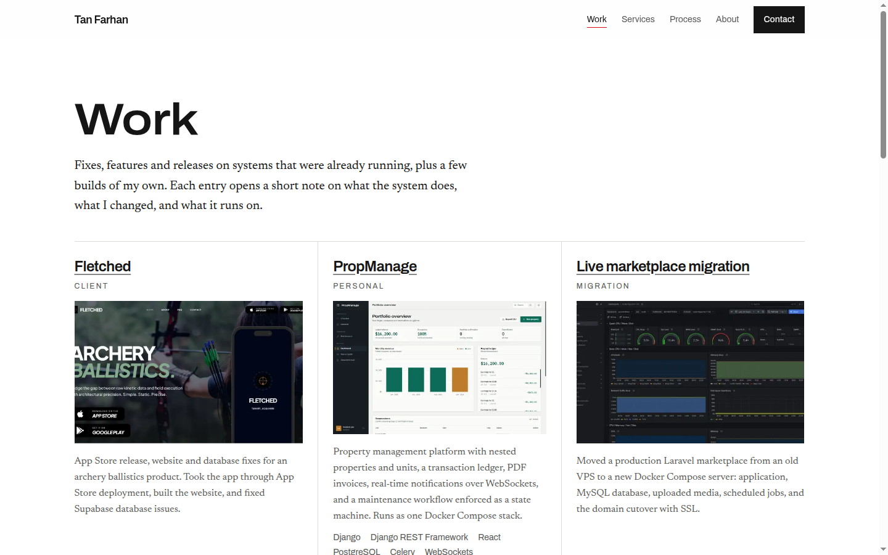

<div align="center">

# Tan Farhan — Portfolio

**Full-stack developer. I build web applications, and finish the ones already started.**

[](https://frhan-portfolio.vercel.app)
[](https://github.com/farhan-t-dev/farhan-portfolio/actions/workflows/ci.yml)
[](https://nextjs.org)
[](https://react.dev)
[](https://www.typescriptlang.org)
[](https://tailwindcss.com)

[Live site](https://frhan-portfolio.vercel.app) · [Work](https://frhan-portfolio.vercel.app/work) · [Email](mailto:farhanweb20@gmail.com) · [LinkedIn](https://www.linkedin.com/in/tanverul-islam-farhan/) · [GitHub](https://github.com/farhan-t-dev)

</div>

<p align="center">
  
  
</p>

This is the source for my portfolio. It is a statically generated Next.js site that shows the work I do — new applications, fixes and features on existing systems, and migrations — and is built to be as considered as the work it describes.

The site is content-driven rather than CMS-driven: identity, projects and skills live in typed data modules, so the pages, sitemap, social cards and structured data all come from one source.

## Selected work

| Project | What it is | Stack |
| --- | --- | --- |
| **[Fletched](https://frhan-portfolio.vercel.app/projects/fletched)** | App Store release, website and Supabase fixes for an archery ballistics product. | React, Vite, Supabase |
| **[Live marketplace migration](https://frhan-portfolio.vercel.app/projects/marketplace-migration)** | A production Laravel marketplace moved to a Docker Compose server — application, MySQL, uploaded media, scheduled jobs, domain and SSL. | Laravel, MySQL, Docker |
| **[PropManage](https://frhan-portfolio.vercel.app/projects/propmanage)** | Property management platform with nested properties, a transaction ledger, PDF invoices, real-time notifications and a maintenance state machine. | Django, React, PostgreSQL |
| **[Parts Seekr](https://frhan-portfolio.vercel.app/projects/parts-seekr)** | Photo-based parts search returning a price-sorted list of listings from eBay and SerpApi. | Next.js, TypeScript, Supabase |
| **[MarketFlow](https://frhan-portfolio.vercel.app/projects/marketflow)** | Multi-vendor B2B marketplace with buyer, seller and admin roles, stock, orders and commission calculation. | Laravel, MySQL, Docker |

The full index — thirteen entries across client work, migrations and personal builds — is at **[frhan-portfolio.vercel.app/work](https://frhan-portfolio.vercel.app/work)**.

<p align="center">
  
</p>

## How I work

1. **Read before quoting.** I go through the existing codebase or production setup before estimating anything.
2. **Write the plan.** Scope, risks and release steps go out in writing before changes start.
3. **Ship reviewable increments.** Changes stay small enough to read in a diff.
4. **Document the handover.** The next person gets the release steps, not just the result.

[Read the full process →](https://frhan-portfolio.vercel.app/#process)

## What's in the build

- **Static by default.** The homepage, the work index and all thirteen project notes are prerendered at build time. There is no database, no runtime API and no client-side data fetching.
- **Generated social cards.** A 1200×630 card is rendered for the site and for every project using `next/og` and the same fonts and palette as the page. Project cards use the project's lead screenshot; projects without one get a typographic card rather than a substitute image. Screenshots are converted from WebP to JPEG for Satori, and the finished cards are quantised to keep every one under WhatsApp's ~300 KB preview limit.
- **Search-ready metadata.** Per-page Open Graph and Twitter tags with absolute image URLs, `sitemap.xml` generated from the project data, `robots.txt`, Person JSON-LD with GitHub and LinkedIn in `sameAs`, and Google Search Console verification.
- **Accessible by construction.** Skip link, semantic landmarks, `sr-only` headings and link text, visible focus states, and a global `prefers-reduced-motion` rule. Colour pairs are held to WCAG AA.
- **Typed content.** Strict TypeScript throughout; project pages, cards and sitemap entries are all derived from `src/data/projects.ts`.
- **Self-hosted type.** Archivo for structure, Newsreader for prose, loaded through `next/font` so there is no render-blocking font request.

## Running locally

Requires Node.js 20.9 or newer.

```bash
npm install
npm run dev
```

Open [http://localhost:3000](http://localhost:3000).

To check the production build:

```bash
npm run build
npm start
```

There are no environment variables to set.

## Project structure

```
.
├── assets/fonts/                 # Static TTFs + OFL licences for the social cards
├── docs/                         # README screenshots and the GitHub social preview
├── public/
│   ├── images/                   # Portrait
│   └── projects/                 # Project screenshots (WebP)
├── src/
│   ├── app/
│   │   ├── page.tsx              # Homepage
│   │   ├── work/page.tsx         # Work index
│   │   ├── projects/[slug]/      # Static project note + its social card
│   │   ├── opengraph-image.tsx   # Site-wide social card
│   │   ├── sitemap.ts            # Sitemap from project data
│   │   ├── robots.ts             # robots.txt
│   │   └── layout.tsx            # Root metadata, JSON-LD, fonts, chrome
│   ├── components/
│   │   ├── layout/               # Header, navigation, footer
│   │   ├── sections/             # Hero, work, services, process, stack, about, contact
│   │   └── ui/                   # Project rows, tiles, tags, availability, icons
│   ├── data/
│   │   ├── site.ts               # Name, role, tagline, contact, profile links
│   │   ├── projects.ts           # Every project entry
│   │   └── skills.ts             # Stack groups
│   └── lib/                      # Fonts, media helpers, social metadata, OG renderers
├── .github/workflows/ci.yml      # Type-check and build on every push
└── package.json
```

## Editing content

| What | Where |
| --- | --- |
| Name, role, tagline, email, availability, profile links | `src/data/site.ts` |
| Projects, screenshots, links, ordering | `src/data/projects.ts` |
| Stack groups | `src/data/skills.ts` |

`site.tagline` is shared by the hero and the site social card, so they cannot drift apart. `site.siteUrl` is the production origin used for canonical URLs, the sitemap and absolute social image URLs.

### Adding a project

1. Add an entry to `src/data/projects.ts` with a unique `slug`, `title`, `description`, `tags`, `kind`, `featured` and `rank`.
2. Drop its screenshot into `public/projects/` and reference it from `images`.
3. That is all. The project page, its social card and its sitemap entry are generated from the data.

Images that are not on disk are skipped rather than rendered as broken frames. A featured project without a screenshot can carry a `scope` list instead, which fills the plate slot with a short ledger of what the work covered.

## Metadata and deployment

The site is deployed on Vercel from `master`, with no environment variables required. The build is fully static; there is no server to provision.

- Sitemap: `https://frhan-portfolio.vercel.app/sitemap.xml`
- Robots: `https://frhan-portfolio.vercel.app/robots.txt`
- Site social card: `https://frhan-portfolio.vercel.app/opengraph-image`

The GitHub social preview lives at `docs/social-preview.png` (1280×640). GitHub does not expose an API for it — upload it under **Settings → Social preview**.

## Reuse

The source is public so the work can be reviewed. There is no open-source licence: the code, written content, project screenshots and portrait are personal work and are not licensed for reuse. If you want to use part of it, [email me](mailto:farhanweb20@gmail.com).
